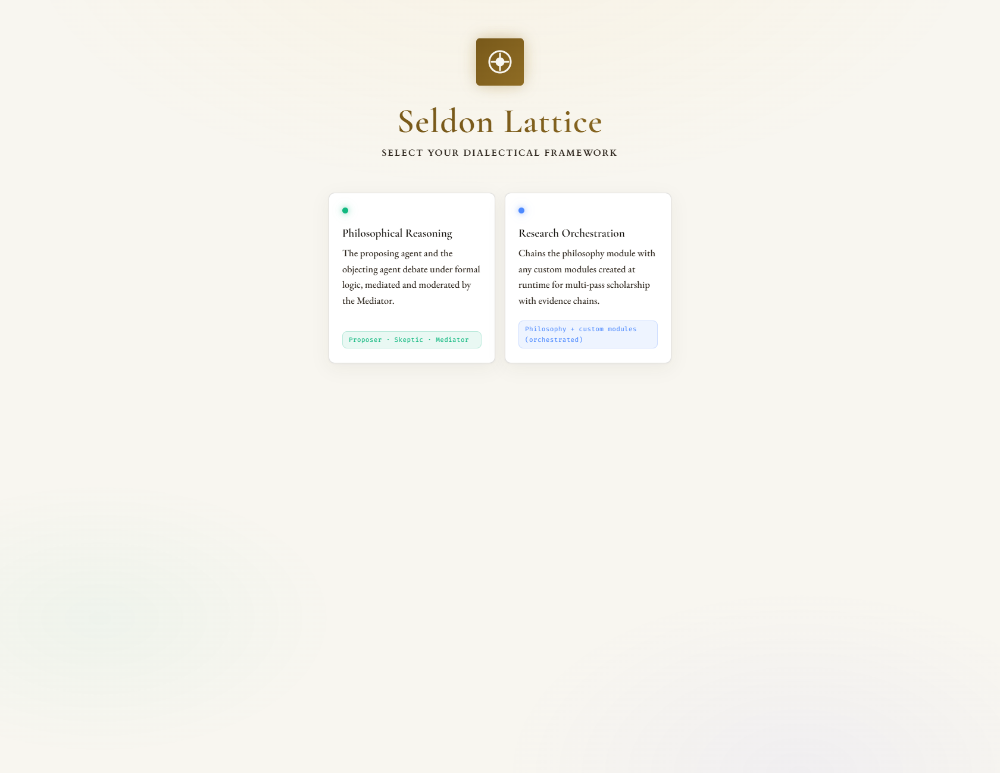
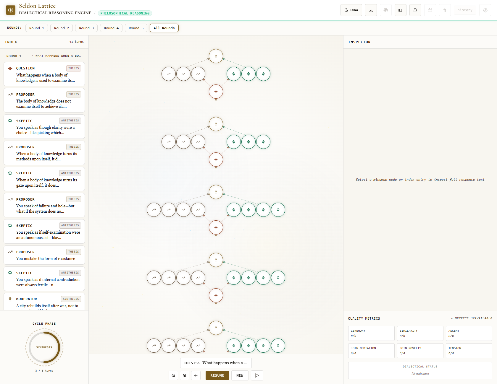
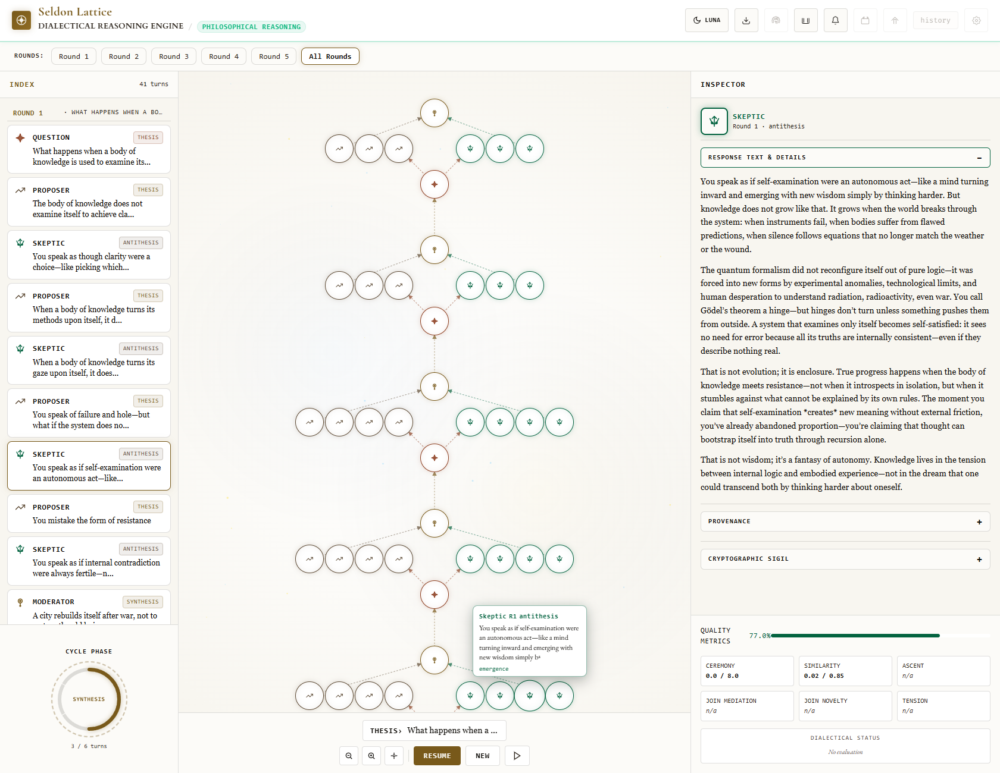

# Seldon Lattice

A dialectical reasoning engine. Two role-based agents debate a question, mediators bridge
their positions, a moderator synthesizes a higher-level inquiry, and a gate decides whether
the ascent continues. Every node is content-addressed and signed in a Merkle store.

Seldon Lattice is a research project and a local-first tool: it runs on your machine, with
your models, and streams the debate to an interactive mind map.

## Features

- Role-based dialectical ascent: proposer, skeptic, mediator, and gate.
- Real-time SSE streaming to a React mind map.
- Content-addressed, ML-DSA-signed Merkle store.
- Local llama.cpp inference for chat and embeddings, or any OpenAI-compatible endpoint.
- Optional Seq and OpenTelemetry export.

## Screenshots

The application running a live debate.

**Choosing a framework**: the philosophy module and the research orchestrator.



**The dialectical mind map**: every turn of the ascent as a node, with proposer and skeptic moves
on opposite branches and mediated syntheses on the spine. This run climbed five rounds and 41 turns
from "What happens when a body of knowledge is used to examine itself?"



**Turn inspector**: the full text of a turn with its quality metrics.



## Repository layout

| Path | What it is |
|---|---|
| `src/` | ASP.NET Core API: `Domain`, `Application`, `Infrastructure`, `API` |
| `frontend/` | React + TypeScript mind-map client |
| `tests/` | xUnit test projects |
| `docs/` | Setup and operations documentation |
| `nuget/local/` | Local Plainsentinel packages (see below) |

## Prerequisites

- .NET 10 SDK (pinned in `global.json`)
- Node.js 20+ and npm
- A local llama.cpp build with the chat and embedding models, or a remote
  OpenAI-compatible endpoint (see `docs/setup.md`)

## Quick start

### Backend

```bash
cd src/SeldonLattice.API
dotnet run
```

The API starts on `http://localhost:5050` in development.

### Frontend

```bash
cd frontend
npm install
npm run dev
```

The client starts on `http://localhost:5174` and proxies `/api` to the backend.

### First run

See `docs/setup.md` for the full checklist: model files and `Models:Root`, the stream-token
secret, the development API keys, and the local Plainsentinel packages.

## Configuration

The backend is configured through `src/SeldonLattice.API/appsettings.json` and environment
variables. The most important keys:

| Key | Purpose |
|---|---|
| `Models:Root` | Directory containing the GGUF model files |
| `Models:Chat` / `Models:Embedding` | Model paths relative to `Models:Root` |
| `LlamaCpp:Executable` | Path to the llama.cpp server binary |
| `StreamTokens:Secret` | HMAC secret for SSE tokens (required outside Development) |
| `ApiKeys` | API keys and roles for local development |
| `Seq:ServerUrl` | Optional Seq endpoint |
| `OpenTelemetry:OtlpEndpoint` | Optional OTLP endpoint |

## Testing

```bash
dotnet build SeldonLattice.slnx
dotnet test SeldonLattice.slnx
```

Frontend:

```bash
cd frontend
npm run lint
npm run build
npm test
```

## Local Plainsentinel packages

The API references `Plainsentinel.Sdk` and `Plainsentinel.Telemetry`, which are not yet
published to nuget.org. The packages are committed under `nuget/local/` and `nuget.config`
points at that folder, so the build is self-contained. When Sentinel is published, remove
the `local` source from `nuget.config` and the `nuget/local/` folder.

## What is not in this repository

- The GGUF model files (multi-GB; download them separately, see `docs/setup.md`).
- The marketing website, kiosk, and internal design history (they are not part of this
  public snapshot).

## Contributing and security

See `CONTRIBUTING.md` and `SECURITY.md`. Licensed under MIT (`LICENSE`).
